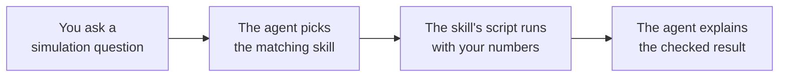

# Materials Simulation Skills

[](https://github.com/HeshamFS/materials-simulation-skills/actions/workflows/ci.yml)
[](https://pypi.org/project/materials-simulation-skills/)
[](LICENSE)
[](https://www.python.org/)
[](https://agentskills.io)

**Give your AI coding agent real expertise in numerical methods, simulation best practices, and computational materials science, so it stops guessing.**

```text
You: Check if dt=0.001 is stable for my advection problem with v=2.0 m/s and dx=0.01.

Agent: I'll use the numerical-stability skill to check this.
       [runs cfl_checker.py --dx 0.01 --dt 0.001 --velocity 2.0 --json]

       CFL number = 0.2 (limit: 1.0) -- stable.
       Recommended max dt = 0.005 with safety factor 1.0.
```

**24 skills** cover numerical methods, simulation workflows, HPC deployment, verification and validation, FAIR data, robustness, and materials ontologies. They follow the open [Agent Skills standard](https://agentskills.io) and work in **20+ tools**, including Claude Code, Codex, Cursor, Antigravity and GitHub Copilot.

---

## How it works



A skill is a folder of instructions plus small, tested scripts. Your agent finds it on its own and loads it only when a question needs it, so there is nothing to wire up and no prompt to write.

---

## Quick start

### 1. Install

```bash
npx skills add HeshamFS/materials-simulation-skills
```

<details>
<summary>Other ways to install</summary>

**Pinned to a release**

```bash
gh skill install HeshamFS/materials-simulation-skills --pin v1.0.0
```

**As a Claude Code plugin**

```text
/plugin marketplace add HeshamFS/materials-simulation-skills
```

**A curated bundle into one agent, with the `mss` CLI**

```bash
pip install materials-simulation-skills
mss bundles                                                  # list bundles
mss install --agent claude --bundle verification-and-validation
```

The per-agent guide is in **[docs/INSTALL.md](docs/INSTALL.md)**.

</details>

### 2. Ask your agent

Describe the task in your own words. The agent picks the skill:

```text
Is dt=0.001 stable for advection with v=2.0 m/s and dx=0.01?
```

```text
My GMRES solve stalls. Which preconditioner should I try?
```

You can also name a skill:

```text
Use convergence-study to check if my mesh is in the asymptotic range:
h = 0.4, 0.2, 0.1 gave stress = 98.5, 99.6, 99.9 MPa.
```

### 3. Check the result

The agent runs the skill's script with your numbers and explains the output, as in the example at the top. Every script also runs by hand, so you can check any answer yourself:

```bash
pip install materials-simulation-skills
mss list                                              # list skills
mss run numerical-stability cfl_checker -- --dx 0.01 --dt 0.001 --velocity 2.0 --json
```

---

## What's inside

**24 skills** in 8 categories. The full catalog is in **[docs/SKILLS.md](docs/SKILLS.md)**, and in machine-readable form in [`skills_index.json`](skills_index.json).

| Category | Skills | Focus |
|---|---|---|
| Core Numerical | 8 | stability, time-stepping, meshing, convergence, integration, differentiation, linear/nonlinear solvers |
| Simulation Workflow | 7 | validation, DOE/optimization, orchestration, post-processing, profiling, workflow mapping, MD analysis |
| Ontology | 3 | CMSO/ASMO exploration, mapping, validation |
| HPC Deployment | 2 | SLURM script generation, runtime diagnosis |
| Verification & Validation | 1 | manufactured solutions, benchmarks, pass/fail reports |
| Data Management | 1 | FAIR reproducibility packaging |
| Robustness | 1 | cross-code failure triage and retry ladders |
| Meta | 1 | `skill-evaluator`: evaluate any skill across any agent CLI |

---

## How it's tested

- **Scripts are tested.** Unit, integration, analytic-oracle and negative-control tests run in CI on Python 3.10 to 3.12 across Linux, macOS and Windows.
- **Documented numbers are checked.** Every eval case runs its script and asserts the exact output, so the docs cannot drift from the code. Latest run ([2026-10-20](docs/evaluations/2026-10-20.md)): 115 cases, 131 checks, 725 assertions passed.
- **Rules cite their source**, such as ASME V&V20, the SchedMD `sbatch` spec and CMSO IRIs.
- **Not yet shown:** that a live agent gives better scientific answers with these skills than without them. The harness to measure it exists, and the work is tracked in [#13](https://github.com/HeshamFS/materials-simulation-skills/issues/13).

Read **[validation scope and remaining limits](docs/VALIDATION_SCOPE.md)** before treating a passing check as evidence about a physical simulation. Method and harness: [evaluation methodology](docs/EVALUATION_METHODOLOGY.md) · [eval harness](docs/EVAL_HARNESS.md).

---

## Contributing

Contributions are welcome: a new skill, a fix, docs, or just an idea.

- **Looking for something to pick up?** See the [roadmap issues](https://github.com/HeshamFS/materials-simulation-skills/issues?q=is%3Aissue+is%3Aopen+label%3Aroadmap) and the [good first issues](https://github.com/HeshamFS/materials-simulation-skills/issues?q=is%3Aissue+is%3Aopen+label%3A%22good+first+issue%22).
- **Have an idea or a skill to propose?** Open an [issue](https://github.com/HeshamFS/materials-simulation-skills/issues/new/choose). Early ideas are useful even without code.
- **Want to build a skill?** **[CONTRIBUTING.md](CONTRIBUTING.md)** has a step-by-step guide with script and test templates. A skill ships a tested script plus an eval case with a deterministic `script_check`, and passes `mss validate` and `mss eval`.
- **Where it's headed:** **[ROADMAP.md](ROADMAP.md)**.

To work on the repository itself:

```bash
git clone https://github.com/HeshamFS/materials-simulation-skills.git
cd materials-simulation-skills && pip install -e ".[dev]"

mss eval                      # run the deterministic eval gate
python -m pytest tests/       # full test suite
```

---

## Documentation

| Doc | What's in it |
|---|---|
| [docs/SKILLS.md](docs/SKILLS.md) | Full skill catalog, how skills work, repo layout |
| [docs/INSTALL.md](docs/INSTALL.md) | Install for every supported agent |
| [docs/EVALUATION_METHODOLOGY.md](docs/EVALUATION_METHODOLOGY.md) | How skills are evaluated, with results |
| [docs/EVAL_HARNESS.md](docs/EVAL_HARNESS.md) | The three-layer evaluation harness |
| [docs/PROTOCOL.md](docs/PROTOCOL.md) | The Materials Simulation Skill Protocol |
| [docs/SECURITY.md](docs/SECURITY.md) | Safeguards and security tiers |
| [CONTRIBUTING.md](CONTRIBUTING.md) · [ROADMAP.md](ROADMAP.md) | Contributing guide · direction |

---

## License

[Apache 2.0](LICENSE)

## Acknowledgements

- [Agent Skills standard](https://agentskills.io): open specification for portable agent capabilities
- [Anthropic](https://anthropic.com): original developer of the Agent Skills format
- [agentskills/agentskills](https://github.com/agentskills/agentskills): reference implementation and validation library
